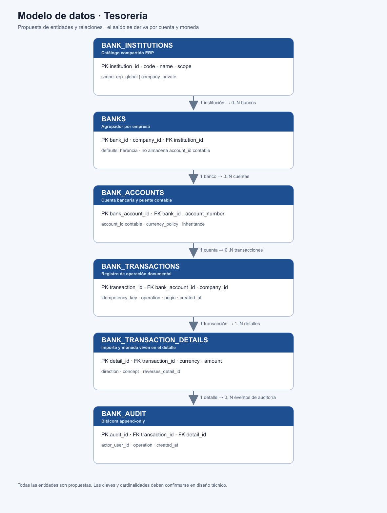
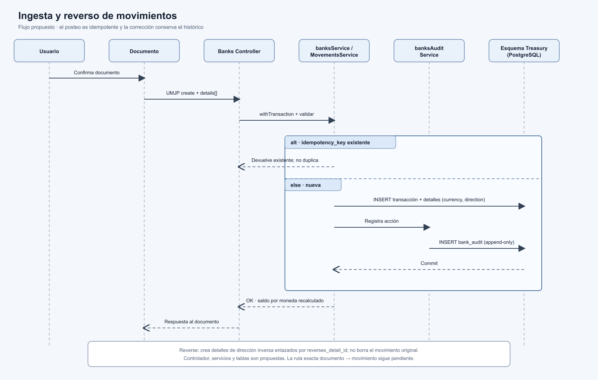

# Paquete de diseño — feature-TreasuryBanks (Etapa 2)

- **Iniciativa:** `treasury-banks`
- **Fecha:** 2026-10-22 · **Revisión:** v1 · **Estado:** Propuesto (pendiente de aprobación)

## Archivos

| Archivo | Audiencia | Propósito | Estado |
|---|---|---|---|
| [feature-design.md](feature-design.md) | Desarrollo, QA, coworkers | Especificación funcional + diseño técnico + criterios de aceptación + diagramas | Propuesto |
| README.md (este) | Orquestador / equipo | Índice del paquete | Propuesto |
| [diagrams/modelo-datos.png](diagrams/modelo-datos.png) | Desarrollo, QA | Imagen renderizada del modelo de datos | Propuesto |
| [diagrams/modelo-datos.svg](diagrams/modelo-datos.svg) | Desarrollo, QA | Versión vectorial del modelo de datos | Propuesto |
| [diagrams/modelo-datos.mmd](diagrams/modelo-datos.mmd) | Desarrollo | Fuente Mermaid editable del modelo de datos | Propuesto |
| [diagrams/secuencia-ingesta-reverse.png](diagrams/secuencia-ingesta-reverse.png) | Desarrollo, QA | Imagen renderizada del flujo de ingesta y reverso | Propuesto |
| [diagrams/secuencia-ingesta-reverse.svg](diagrams/secuencia-ingesta-reverse.svg) | Desarrollo, QA | Versión vectorial de la secuencia | Propuesto |
| [diagrams/secuencia-ingesta-reverse.mmd](diagrams/secuencia-ingesta-reverse.mmd) | Desarrollo | Fuente Mermaid editable de la secuencia | Propuesto |

## Diagramas (imágenes en el documento y fuentes Mermaid editables)

- **Modelo de datos (§6.1)** — responde: ¿cómo se relacionan institución, banco, cuenta, transacción, detalle y auditoría, y dónde viven la moneda y el puente contable?
- **Secuencia de ingesta + reverse (§6.2)** — responde: ¿qué ocurre, en orden, al registrar un movimiento desde un documento y cómo se deshace sin borrar?

Se eligió **Mermaid** como fuente editable y versionable; el paquete incluye gráficos SVG y vistas PNG que se visualizan directamente en `feature-design.md`.

**Diagramas evaluados y omitidos:** arquitectura de módulos y ciclo de vida del movimiento — no reducían ambigüedad respecto a la secuencia y la prosa (ver §6.3).

## Limitaciones / consistencia a conservar

- Nombres de tablas (`bank_institutions`, `banks`, `bank_accounts`, `bank_transactions`, `bank_transaction_details`, `bank_audit`) y endpoints (`/treasury/banks/*`) son **Propuesta** — no existen aún.
- **Pendiente P1:** ruta exacta documento→movimiento, por confirmar antes de la Etapa 4.
- **Supuesto S1:** `account_id` proviene del plan de cuentas existente.
- **Decisiones abiertas D1–D4** afectan detalle fino, no el plan por etapas.
