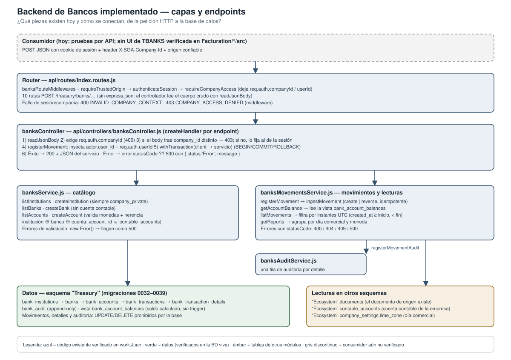
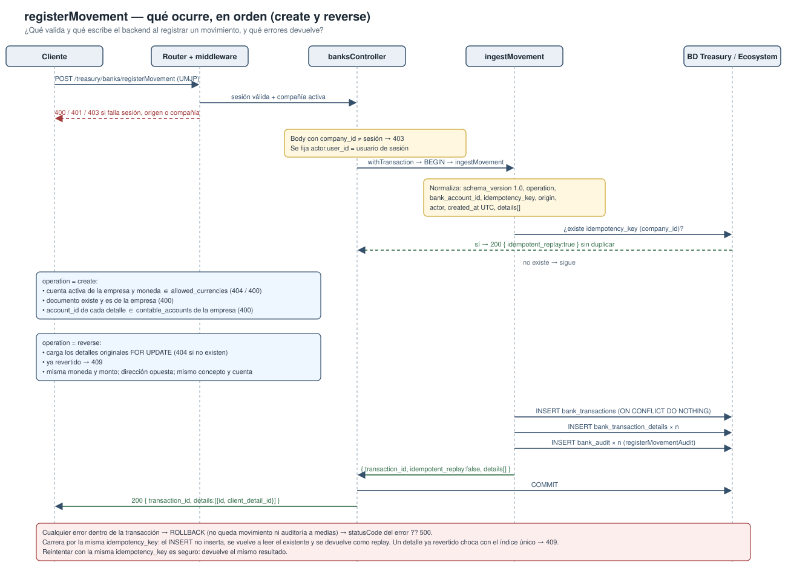

# Backend de Bancos (Tesorería) — lo que hay implementado hoy

- **Iniciativa:** `treasury-banks` · **Complementa:** [feature-design.md](feature-design.md) (diseño v1) y [estructura-bd-implementada.md](estructura-bd-implementada.md) (esquema)
- **Fecha:** 2026-11-20 · **Revisión:** v1 · **Estado:** Borrador (pendiente de revisión)
- **Rama verificada:** `work.Juan` (commit `95661c6f`). Todo lo descrito como "existe" se leyó en el código de esa rama; los datos se contrastaron con la BD viva solo con consultas de metadatos (`information_schema`, `schema_migrations`) y el conteo de `bank_transactions` (0 filas).
- **Para qué sirve este documento:** que QA y desarrollo sepan qué hay, para qué sirve y cómo se comporta el backend de Bancos **antes de empezar a probarlo**. No propone cambios.

## 1. Propósito y resumen

- **Problema que resuelve:** llevar el saldo de las cuentas bancarias de cada empresa, **por moneda**, a partir de los documentos que mueven dinero (ventas, compras, ingresos, egresos, ajustes), sin borrar ni editar nunca un movimiento.
- **Qué hay hoy:** un backend de 10 endpoints `POST /treasury/banks/*` con su controlador, tres servicios, 7 estructuras en `"Treasury"` y pruebas unitarias de servicio.
- **Qué NO hay (verificado):** pantallas de Bancos (sin referencias a `treasury/banks` en `Facturation/*/src`) ni integración que genere movimientos automáticamente desde los documentos. Hoy un movimiento solo entra si alguien llama a `registerMovement`.
- **Cómo funciona en una frase:** se configura *institución → banco → cuenta*; cada documento envía un movimiento (`create`) con uno o más detalles (moneda, monto, entrada/salida); deshacer es enviar un `reverse` que lo anula; el saldo se calcula al consultar.

## 2. Alcance

| Dentro (existe) | Fuera (no existe o no se verificó) |
|---|---|
| Catálogo: instituciones, bancos, cuentas | Frontend de Tesorería/Bancos |
| Movimientos `create` y `reverse`, idempotentes | Generación automática de movimientos desde documentos |
| Saldo por moneda, listado e informes por día comercial | Conciliación bancaria (decisión: fuera de alcance) |
| Auditoría append-only por detalle | Edición/borrado de catálogo (no hay endpoints `update`/`delete`) |
| Aislamiento por empresa en middleware, controlador, servicios y BD | Ruta aparte para reversos (se hace con `registerMovement`) |

## 3. Qué hay y cómo se conecta

Fuente editable: [backend-arquitectura.mmd](diagrams/backend-arquitectura.mmd). **Pregunta que responde:** ¿qué piezas existen hoy y cómo se conectan, de la petición HTTP a la BD?

Resumen de cada capa:

- **Router** ([index.routes.js](../../../../api/routes/index.routes.js)): las 10 rutas pasan por `requireTrustedOrigin → authenticateSession → requireCompanyAccess`. Hace falta cookie de sesión, un origen confiable y el header `X-SGA-Company-Id` de una compañía a la que el usuario pertenezca.
- **Controlador** ([banksController.js](../../../../api/controllers/banksController.js)): un `createHandler` común. Lee el cuerpo con `readJsonBody`, **toma la empresa de la sesión** (si el body trae otro `company_id` responde 403), en `registerMovement` fija `actor.user_id` con el usuario de sesión y ejecuta el servicio dentro de `withTransaction`.
- **Servicios** ([banksService.js](../../../../api/services/banksService.js), [banksMovementsService.js](../../../../api/services/banksMovementsService.js), [banksAuditService.js](../../../../api/services/banksAuditService.js)): lógica y SQL con parámetros `$n`, siempre filtrada por `company_id`.
- **Datos:** esquema `"Treasury"` (ver [estructura-bd-implementada.md](estructura-bd-implementada.md)). Se leen además `"Ecosystem".documents`, `"Ecosystem".contable_accounts` y `"Ecosystem".company_settings.time_zone`.

## 4. Endpoints y qué hace cada uno

Todos son `POST`, responden JSON y toman `company_id` de la sesión (no hace falta enviarlo).

| Endpoint | Servicio | Qué hace | Campos clave del body |
|---|---|---|---|
| `/treasury/banks/listInstitutions` | `listInstitutions` | Instituciones activas: globales (`erp_global`) y privadas de la empresa | — |
| `/treasury/banks/createInstitution` | `createInstitution` | Crea una institución **siempre `company_private`** | `code`, `name`, `parametrization` con al menos un país y una moneda de operación |
| `/treasury/banks/listBanks` | `listBanks` | Bancos de la empresa | — |
| `/treasury/banks/createBank` | `createBank` | Crea un banco bajo una institución visible para la empresa. Rechaza `account_id` (el banco no lleva cuenta contable) | `institution_id`, `alias` o `name`, `defaults` |
| `/treasury/banks/listAccounts` | `listAccounts` | Cuentas de la empresa | — |
| `/treasury/banks/createAccount` | `createAccount` | Crea una cuenta: valida monedas contra institución y banco, resuelve la herencia y exige que la cuenta contable sea de la empresa | `bank_id`, `account_id`, `account_number`, `currency_policy` (`allowed_currencies`, `primary_currency`) |
| `/treasury/banks/registerMovement` | `ingestMovement` | Registra un movimiento `create` o `reverse` (ver §5) | UMJP: `schema_version:"1.0"`, `operation`, `bank_account_id`, `idempotency_key`, `created_at` (UTC), `origin{module,document_type,document_id}`, `details[]` |
| `/treasury/banks/getAccountBalance` | `getAccountBalance` | Saldo de una cuenta, una fila por moneda (`total_in`, `total_out`, `balance`, `detail_count`, `last_movement_at`) desde la vista `bank_account_balances` | `bank_account_id` |
| `/treasury/banks/listMovements` | `listMovements` | Movimientos de una cuenta con sus detalles, más recientes primero. Filtra por **instantes UTC**: `created_at >= start_date` y `< end_date` | `bank_account_id`, `start_date?`, `end_date?` |
| `/treasury/banks/getReports` | `getReports` | Totales por **día comercial**, cuenta y moneda: `total_in`, `total_out`, `net_total`, `transaction_count`, `detail_count` | `bank_account_id?`, `start_date?`, `end_date?` (formato `YYYY-MM-DD`, ambos incluidos) |

Contratos campo a campo del UMJP: [docs/bancos/contratos-json-bancos.md](../../../bancos/contratos-json-bancos.md). Ojo: ese contrato y el diseño v1 usan `uuid` para IDs; la BD real usa `bigint` (el `detail_id` del emisor sí es `uuid`, guardado en `client_detail_id`).

## 5. Cómo se registra un movimiento

Fuente editable: [backend-registro-movimiento.mmd](diagrams/backend-registro-movimiento.mmd). **Pregunta que responde:** ¿qué valida y qué escribe el backend al registrar un movimiento, y qué errores devuelve?

Reglas observables (verificadas en `banksMovementsService.js`):

- **Idempotencia:** misma `idempotency_key` + misma empresa devuelve el movimiento existente con `idempotent_replay: true` y no escribe nada. Si dos peticiones compiten, el `INSERT … ON CONFLICT DO NOTHING` hace que la segunda lea y devuelva la existente.
- **`create`:** la cuenta debe existir, estar activa y ser de la empresa (404); cada moneda debe estar en `currency_policy.allowed_currencies` de la cuenta (400); el documento de `origin.document_id` debe ser de la empresa (400); si el detalle trae `account_id`, debe existir en `contable_accounts` de la empresa (400).
- **`reverse`:** cada detalle apunta (por `reverses_detail_id`, el `detail_id` del original) a un detalle `create` de la misma cuenta. Debe tener misma moneda, mismo monto, dirección opuesta, mismo concepto y misma cuenta contable. Si el original no existe → 404; si ya fue revertido → 409.
- **Atomicidad:** transacción + detalles + auditoría se escriben en la misma transacción; cualquier error hace ROLLBACK.
- **Auditoría:** una fila en `bank_audit` por detalle, con el payload completo del detalle.
- **Nada se edita ni se borra:** la BD rechaza `UPDATE`/`DELETE` sobre movimientos, detalles y auditoría (ver estructura implementada).

## 6. Criterios de aceptación para probar

Sugeridos a partir del comportamiento verificado; **no hay pruebas de integración ejecutadas** (ver §9).

1. Una petición sin sesión, sin origen confiable o sin `X-SGA-Company-Id` válido es rechazada antes de llegar al servicio.
2. Un body con `company_id` distinto al de la sesión responde 403.
3. Crear institución, banco y cuenta en ese orden funciona; una cuenta con una moneda no permitida por institución o banco falla.
4. `registerMovement` `create` con dos monedas distintas produce un saldo por moneda en `getAccountBalance`.
5. Repetir la misma `idempotency_key` no duplica ni cambia el saldo y devuelve `idempotent_replay: true`.
6. Un `reverse` exacto deja el saldo en cero para esa moneda; un segundo `reverse` del mismo detalle responde 409.
7. Un `reverse` con monto, moneda o dirección distintos al original falla (400).
8. `getReports` agrupa por día comercial de la empresa: un movimiento cerca de medianoche cae en el día correcto según `company_settings.time_zone` (o `context.time_zone` / `context.business_date` si vienen).
9. Una empresa nunca ve cuentas, movimientos ni saldos de otra.

## 7. Errores, límites y casos especiales

- **Los errores de `banksService` salen como 500.** `createInstitution`, `createBank` y `createAccount` validan con `new Error(...)` sin `statusCode`, y el controlador responde `error.statusCode ?? 500`. Un dato inválido del usuario (p. ej. falta el nombre) devuelve 500 en lugar de 400. `banksMovementsService` sí usa 400/404/409. *Hecho verificado; si es deseable o no es decisión del equipo.*
- **`listMovements` y `getReports` filtran distinto.** El primero recibe instantes UTC; el segundo recibe fechas comerciales y calcula el día con `context.business_date`, si no `context.time_zone`, si no la zona de la compañía (`companyTimeZoneSql`).
- **Cuentas contables del plan compartido (`company_id = 0`):** `createAccount`, `registerMovement` y los triggers `validate_bank_account_ledger` / `validate_bank_detail` aceptan cuentas de la empresa o del plan compartido. La migración `db/migrations/0040_bank_allow_shared_ledger_accounts.sql` se aplicó en la BD viva el 2026-11-20 (con autorización explícita; rollback en el archivo `.rollback.sql`). Verificado en una transacción con ROLLBACK: cuenta global aceptada; cuenta de otra empresa rechazada.
- **No hay `update`/`delete` de instituciones, bancos ni cuentas** (solo `is_active` en BD, sin endpoint).
- **`updated_at` no se actualiza solo** (sin trigger); como no hay endpoints de edición, hoy no aplica.

## 8. Decisiones, supuestos y preguntas abiertas

| Tipo | Detalle |
|---|---|
| Decisión aplicada | Saldo por moneda derivado (vista), movimientos append-only, reverse en lugar de modificar, catálogo mixto global/privado, `concept` abierto (D1–D4) |
| **Discrepancia a resolver** | Los servicios usan `bank_transaction_details.client_detail_id`, `bank_transaction_details.metadata` y `bank_transactions.description`. Esas columnas las crea la migración **`0039_add_bank_contract_fields`**, que figura aplicada en la BD viva (`schema_migrations`, 2026-11-18) pero **el archivo no está en `db/migrations/` de `work.Juan`**; existe en el commit `a527b354` de la rama `test`. Quien pruebe en `work.Juan` debe saber que el código depende de ese archivo. |
| Documentos desactualizados | [feature-design.md](feature-design.md) y el [README.md](README.md) del paquete aún marcan endpoints y tablas como "Propuesta / no existen aún"; [estructura-bd-implementada.md](estructura-bd-implementada.md) dice que no hay API y no incluye las columnas de `0039`. |
| Pregunta abierta | ¿Los errores de validación de `banksService` deben devolver 400? |
| Decisión aplicada | Cuentas contables globales (`company_id = 0`) permitidas en cuentas bancarias y detalles (migración 0040 aplicada 2026-11-20). |
| Pendiente | P1 sigue abierto: la ruta exacta documento → `registerMovement` (la integración no existe todavía). |

## 9. Validación

- **Existe (no ejecutado en esta revisión):** tres suites unitarias en `api/test/services/` — `banksService.test.js` (589 líneas), `banksMovementsService.test.js` (995) y `banksAuditService.test.js` (151). `package.json` no define un script `test`.
- **Sugerido, en este orden:** (1) correr las tres suites; (2) pruebas por API con el flujo catálogo → movimiento → saldo → reverso → informe, en una compañía de prueba y respetando [AGENTS.md](../../../../AGENTS.md) (solo operaciones aditivas; el ambiente de conexión debe identificarse antes de escribir); (3) casos de medianoche y zonas con horario de verano en `getReports`.

## 10. Referencias

- Código: [index.routes.js](../../../../api/routes/index.routes.js), [banksController.js](../../../../api/controllers/banksController.js), [banksService.js](../../../../api/services/banksService.js), [banksMovementsService.js](../../../../api/services/banksMovementsService.js), [banksAuditService.js](../../../../api/services/banksAuditService.js), [businessTimeZoneService.js](../../../../api/services/businessTimeZoneService.js)
- Migraciones: `db/migrations/0032`–`0038` en esta rama; `0039` en la rama `test` (commit `a527b354`)
- Diseño y plan: [feature-design.md](feature-design.md), [task-plan.md](../03-execution/task-plan.md), [00-orchestration.md](../00-orchestration.md)
