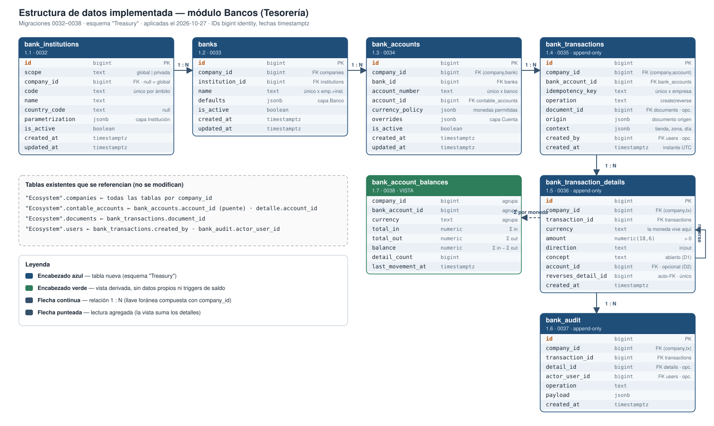
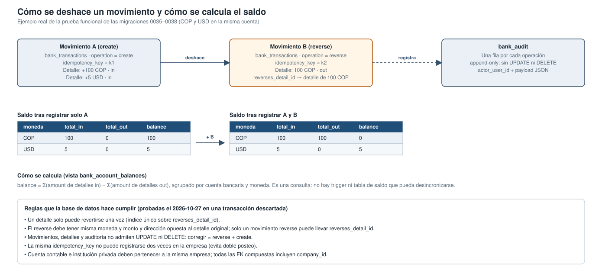

# Estructura de datos implementada — módulo Bancos (Tesorería)

- **Iniciativa:** `treasury-banks` · **Complementa:** [feature-design.md](feature-design.md) (v1, diseño propuesto)
- **Fecha:** 2026-10-27 · **Revisión:** v1 · **Estado:** Borrador (pendiente de revisión)
- **Origen:** migraciones `0032`–`0038` (commit `7d37ecb0`), aplicadas en la base de datos viva el 2026-10-27. Campos verificados con una consulta de solo lectura a `information_schema`.

## 1. Resumen ejecutivo

- Se creó la base de datos del módulo Bancos con **6 tablas y 1 vista** en el esquema `"Treasury"`. Es 100 % aditiva: no se modificó ninguna tabla existente y las tablas nuevas están vacías.
- La jerarquía queda en cinco niveles: **institución → banco → cuenta → movimiento → detalle**, más una bitácora de auditoría. Cada cuenta bancaria se une a la contabilidad por `account_id` (`"Ecosystem".contable_accounts`).
- **La moneda vive en el detalle del movimiento**, así que cada cuenta tiene un saldo por moneda (COP, USD…). El saldo no se guarda: lo calcula la vista `bank_account_balances`, lo que evita el tipo de desincronización del bug de doble saldo del cierre de caja.
- **Nada se borra ni se edita.** Movimientos, detalles y auditoría rechazan `UPDATE` y `DELETE` en la propia base de datos. Corregir un movimiento es crear un `reverse` que lo anula, y la base impide revertir dos veces el mismo detalle.
- **Aislamiento por empresa:** todas las tablas llevan `company_id` y las llaves foráneas son compuestas, de modo que un banco, una cuenta o un movimiento no pueden mezclarse con otra empresa.
- **Doble posteo evitado** por `idempotency_key`, única por empresa.
- **Reglas probadas** el 2026-10-27 en una transacción que se descartó: saldo por moneda, reverse, doble reverse, `UPDATE`/`DELETE` prohibidos, clave duplicada y reverse con moneda distinta. No quedó ningún dato de prueba.
- **Qué falta:** no hay todavía API, servicios ni pantallas que usen estas tablas (Etapas 2 a 4 del plan).

## 2. Diagrama de la estructura

**Pregunta que responde:** ¿qué tablas y campos existen, y cómo se relacionan?

Fuente editable (relaciones): [bd-implementada-er.mmd](diagrams/bd-implementada-er.mmd). El SVG se dibujó a mano porque no hay renderizador de Mermaid instalado; si cambia el esquema, hay que actualizar ambos.

## 3. Cómo se deshace un movimiento y cómo se calcula el saldo

**Pregunta que responde:** ¿qué pasa con el saldo al revertir, y qué reglas lo protegen?

Fuente editable: [bd-implementada-reverse-saldo.mmd](diagrams/bd-implementada-reverse-saldo.mmd).

## 4. Campos nuevos por tabla

Todas las tablas usan `id bigint GENERATED ALWAYS AS IDENTITY` y fechas `timestamptz`. Los nombres siguen el estilo de `"Treasury"` (snake_case).

| Tabla (migración · tarea) | Campos | Reglas propias |
|---|---|---|
| `bank_institutions` (0032 · 1.1) | `scope` (`erp_global`/`company_private`), `company_id` (nulo si es global), `code`, `name`, `country_code`, `parametrization` (JSON), `is_active`, `created_at`, `updated_at` | Global ⇔ sin `company_id`; privada ⇔ con `company_id`. `code` único por ámbito. |
| `banks` (0033 · 1.2) | `company_id`, `institution_id`, `name`, `defaults` (JSON), `is_active`, fechas | Único por empresa + institución + nombre. Una institución privada solo la usa su empresa. No apunta a cuenta contable. |
| `bank_accounts` (0034 · 1.3) | `company_id`, `bank_id`, `account_number`, `account_id` (puente contable), `currency_policy` (JSON), `overrides` (JSON), `is_active`, fechas | Número único por banco. La cuenta contable debe ser de la misma empresa. |
| `bank_transactions` (0035 · 1.4) | `company_id`, `bank_account_id`, `idempotency_key`, `operation` (`create`/`reverse`), `document_id`, `origin` (JSON), `context` (JSON), `created_by`, `created_at` | Append-only. `idempotency_key` única por empresa. `created_at` es el instante UTC; el día comercial va en `context`. |
| `bank_transaction_details` (0036 · 1.5) | `company_id`, `transaction_id`, `currency`, `amount` (> 0), `direction` (`in`/`out`), `concept`, `account_id`, `reverses_detail_id`, `created_at` | Append-only. Un reverse exige `reverses_detail_id`, misma moneda y monto, y dirección opuesta. Un detalle se revierte una sola vez. |
| `bank_audit` (0037 · 1.6) | `company_id`, `transaction_id`, `detail_id`, `actor_user_id`, `operation`, `payload` (JSON), `created_at` | Append-only. |
| `bank_account_balances` (0038 · 1.7, vista) | `company_id`, `bank_account_id`, `currency`, `total_in`, `total_out`, `balance`, `detail_count`, `last_movement_at` | Se calcula al consultar; sin trigger ni tabla de saldo. |

Decisiones aplicadas: D1 `concept` abierto · D2 `account_id` del detalle opcional · D3 solo `create`/`reverse` · D4 catálogo de instituciones mixto. S1 confirmado (`contable_accounts`).

## 5. Diferencias respecto al diseño v1

- Los IDs son `bigint` y no `uuid` como mostraba [modelo-datos.mmd](diagrams/modelo-datos.mmd), para seguir el esquema vivo. Ese diagrama y los contratos de `docs/bancos/contratos-json-bancos.md` quedan desactualizados en este punto.
- `operation` no admite `modify` (D3).
- Se agregaron `is_active`, `updated_at`, `country_code`, `parametrization` y `payload`, que el diagrama v1 no listaba.

## 6. Límites y pendientes

- `updated_at` no se actualiza solo: no hay trigger. El servicio de la Etapa 2 debe escribirlo.
- `bank_transactions.document_id` no valida la empresa del documento, porque `"Ecosystem".documents` no tiene una unicidad `(company_id, id)` y no se alteró esa tabla. Lo debe validar el servicio.
- El rollback de cada migración solo funciona mientras sus tablas estén vacías.
- No se probaron zonas horarias ni horario de verano: la base solo guarda el instante UTC; esas pruebas corresponden a la API.

---

_feature-TreasuryBanks · estructura implementada · v1 · 2026-10-27 · Borrador_
