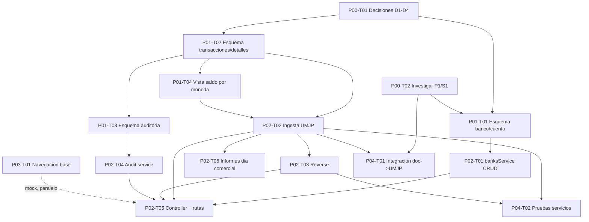

# Plan de ejecución — feature-TreasuryBanks

- **Iniciativa:** `treasury-banks`
- **Etapa:** 3 — Plan de ejecución (**modo plan-only**, sin publicar en Notion)
- **Revisión:** v1 · **Fecha:** 2026-10-22 · **Estado:** Propuesto (pendiente de aprobación)
- **Fuentes aprobadas:** [01-planning/feature-plan.md](../01-planning/feature-plan.md) (aprobado), [02-design/feature-design.md](../02-design/feature-design.md) (aprobado)
- **Estado de publicación en Notion:** no publicado — plan-only. Destino (hoja/base) **sin identificar**; se requiere confirmación del orquestador y un tablero inequívoco para publicar.

---

## 1. Síntesis del plan

- **Inicio recomendado:** arrancar por **P00** (cerrar decisiones D1–D4 e investigar P1/S1). Es lo que más incertidumbre reduce y desbloquea el esquema, la API y la integración. En paralelo puede empezar el **esqueleto de UI (P03-T01)** contra el contrato ya definido en Fase 0.
- **Habilitadores:** el esquema (**P01**) es la base física; la API/servicios (**P02**) dependen de él; el **FE (P03)** avanza en paralelo contra el contrato; la **integración + pruebas (P04)** cierra.
- **Camino crítico:** P00 → P01 → P02 → P04. El FE (P03) es mayormente paralelo.
- **Trabajo paralelo:** P03 (UI con mock) con P02; pruebas de contrato con la API; parametrización UI con el servicio de bancos.
- **Riesgo principal del camino crítico:** **P1** (ruta exacta documento→movimiento) bloquea la integración (P04-T01); por eso P00-T02 es prioritario.

## 2. Árbol de etapas y tareas

IDs estables con prefijo `SGA-FEAT-TBANKS`. Estado lógico: **Disponible** (sin dependencias pendientes) / **Bloqueada** (nombra su desbloqueador). Tamaño cualitativo S/M/L.

### P00 — Decisiones e investigación (habilitadores)

| ID | Título | Dep. | Estado | Tamaño | CA |
|---|---|---|---|---|---|
| TBANKS-P00-T01 | Cerrar decisiones D1–D4 (enum `concept`, `account_id` en detalle, `modify` vs `reverse`, catálogo instituciones) | — | **Disponible** (decisión del usuario) | S | habilita CA1–CA5 |
| TBANKS-P00-T02 | Investigar (solo lectura) la ruta exacta documento→movimiento (P1) y confirmar origen de `account_id` en el plan de cuentas (S1) | — | **Disponible** | M | habilita CA1, integración |

### P01 — Datos (esquema aditivo en `"Treasury"`)

| ID | Título | Dep. | Estado | Tamaño | CA |
|---|---|---|---|---|---|
| TBANKS-P01-T01 | Migración aditiva: `bank_institutions`, `banks`, `bank_accounts` (con `account_id` puente) | P00-T01, P00-T02(S1) | Bloqueada → por D4/S1 | M | CA1, CA8 |
| TBANKS-P01-T02 | Migración aditiva: `bank_transactions` + `bank_transaction_details` (`currency`, `direction`, `concept`, `reverses_detail_id`) + unicidad por `idempotency_key` | P00-T01 | Bloqueada → por D1/D2 | M | CA2, CA3, CA8 |
| TBANKS-P01-T03 | Migración aditiva: `bank_audit` append-only | P01-T02 | Bloqueada → por P01-T02 | S | CA5, CA8 |
| TBANKS-P01-T04 | Consulta/vista de **saldo por moneda** (derivado, sin trigger) agrupado por `(bank_account_id, currency)` | P01-T02 | Bloqueada → por P01-T02 | S | CA2 |

### P02 — API y servicios

| ID | Título | Dep. | Estado | Tamaño | CA |
|---|---|---|---|---|---|
| TBANKS-P02-T01 | `banksService`: CRUD bancos/cuentas + resolución de parametrización con herencia | P01-T01 | Bloqueada → por P01-T01 | M | CA1 |
| TBANKS-P02-T02 | `banksMovementsService`: ingesta UMJP `create` (normalización, **idempotencia**, saldo por moneda) | P01-T02, P01-T04 | Bloqueada → por P01 | L | CA2, CA3 |
| TBANKS-P02-T03 | `banksMovementsService`: **reverse** a nivel detalle (enlaza `reverses_detail_id`, recompone saldo) | P02-T02, P01-T03 | Bloqueada → por P02-T02 | M | CA4 |
| TBANKS-P02-T04 | `banksAuditService`: bitácora append-only write-through | P01-T03 | Bloqueada → por P01-T03 | S | CA5 |
| TBANKS-P02-T05 | `banksController` + rutas `POST /treasury/banks/*` (registerMovement, banks/accounts CRUD, getAccountBalance, listMovements, getReports, instituciones) con scoping por `company_id` | P02-T01..T04 | Bloqueada → por servicios | L | CA7 |
| TBANKS-P02-T06 | Lecturas de saldo por moneda e **informes por día comercial** (`businessTimeZoneService`) | P02-T02 | Bloqueada → por P02-T02 | M | CA6 |

### P03 — Frontend (módulo Tesorería)

| ID | Título | Dep. | Estado | Tamaño | CA |
|---|---|---|---|---|---|
| TBANKS-P03-T01 | Navegación base `buscar banco → cuentas → secciones` (reutiliza `universalTable`/iconos) | Contrato Fase 0 | **Disponible con mock** (integra con P02-T05) | M | — |
| TBANKS-P03-T02 | Sección **Movimientos** (saldo por moneda, ingresos/egresos) | P03-T01, P02-T02/T06 | Bloqueada → por API | M | CA2 (UI) |
| TBANKS-P03-T03 | Sección **Información General** (columnas por cuenta) | P03-T01, P02-T01 | Bloqueada → por API | S | CA1 (UI) |
| TBANKS-P03-T04 | Sección **Acciones → Documentos** (lanzar create docs) + Editor/Eliminar/Config/Duplicar | P03-T01, P04-T01 | Bloqueada → por integración | M | — |
| TBANKS-P03-T05 | Secciones **Informes y Estadísticas** | P03-T01, P02-T06 | Bloqueada → por API | M | CA6 (UI) |
| TBANKS-P03-T06 | UI de **Parametrización** banco/cuenta (herencia visible) | P03-T01, P02-T01 | Bloqueada → por API | M | CA1 (UI) |

### P04 — Integración y pruebas

| ID | Título | Dep. | Estado | Tamaño | CA |
|---|---|---|---|---|---|
| TBANKS-P04-T01 | Integrar emisión del **UMJP desde documentos** → `banksService.registerMovement` dentro de la transacción del documento | P00-T02(P1), P02-T02 | Bloqueada → por P1 + P02-T02 | L | CA2 (integración) |
| TBANKS-P04-T02 | Pruebas unitarias: saldo por moneda, reverse, idempotencia | P02-T02, P02-T03 | Bloqueada → por servicios | M | CA2, CA3, CA4 |
| TBANKS-P04-T03 | Pruebas de día comercial (medianoche / DST) | P02-T06 | Bloqueada → por P02-T06 | S | CA6 |
| TBANKS-P04-T04 | Pruebas de permisos multiempresa + migración apply/rollback + regresión Tesorería | P01-*, P02-T05 | Bloqueada → por esquema/API | M | CA7, CA8 |

## 3. Grafo de dependencias

## 4. Disponible ahora / paralelo / bloqueado

- **Disponible ahora:** `P00-T01` (decisión), `P00-T02` (investigación read-only), `P03-T01` (UI base con mock).
- **Se desbloquea al cerrar P00:** todo P01 → luego P02 → luego P04.
- **Paralelo:** P03 (UI) con P02 (API) una vez estable el contrato; `P04-T02/T03` con el desarrollo de servicios.
- **Bloqueado por decisión:** P01-T01/T02 (D1/D2/D4), toda la cadena aguas abajo.
- **Bloqueado por investigación:** `P04-T01` por **P1** (ruta doc→movimiento).
- **Punto de integración:** `P04-T01` junta documentos + banca; validar con `P04-T02/T03/T04`.

## 5. Cobertura de criterios de aceptación

| CA | Tareas que lo cubren |
|---|---|
| CA1 | P01-T01, P02-T01, P03-T03/T06 |
| CA2 | P01-T02, P01-T04, P02-T02, P03-T02, P04-T01/T02 |
| CA3 | P01-T02, P02-T02, P04-T02 |
| CA4 | P02-T03, P04-T02 |
| CA5 | P01-T03, P02-T04 |
| CA6 | P02-T06, P03-T05, P04-T03 |
| CA7 | P02-T05, P04-T04 |
| CA8 | P01-T01/T02/T03, P04-T04 |

Sin huecos: cada CA del diseño tiene al menos una tarea. Las decisiones D1–D4 y el pendiente P1 están modelados como tareas propias (P00), no escondidos en tickets de implementación.

## 6. Estado de Notion y próximos pasos

- **Publicación:** no solicitada aún / **plan-only**. Para publicar se necesita: (a) aprobación explícita del orquestador y (b) la **hoja/base de Notion destino inequívoca**. El conector de Notion debe estar autorizado en la sesión.
- Al publicar: se mapearían los campos lógicos (título, objetivo, dependencias, criterios, estado Disponible/Bloqueada) al esquema existente del tablero, sin crear estados nuevos ni tocar tareas existentes; se detectarían duplicados por el ID estable `SGA-FEAT-TBANKS-*`.

---

_Etapa 3 · feature-TreasuryBanks · v1 · 2026-10-22 · Propuesto (plan-only)_
